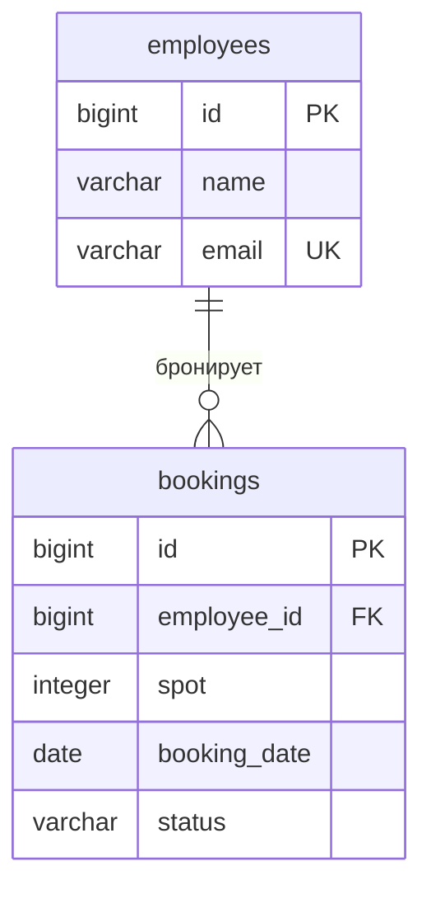

# Корпоративная парковка — КР2

Java 21, JavaFX 21, FXML, CSS, PostgreSQL 18 в Docker, JDBC. Сотрудники и бронирование одного из 50 мест на целый день.

## Как пользоваться

**Откройте Docker Desktop и дважды нажмите `run.cmd`.** Запустится база в Docker, затем графическое приложение. Данные и правила сохранены из КР1.

- **Бронирования**: таблица, добавление, изменение и удаление с подтверждением. Выберите строку, чтобы увидеть почту сотрудника и сменить статус.
- **Сотрудники**: список и добавление сотрудника. В форме бронирования сотрудник выбирается из списка.
- **Статистика**: 7 показателей по всей базе, независимо от фильтров таблицы.
- Поиск работает по ФИО, почте и точному номеру места. Фильтры статуса и периода применяются вместе кнопкой «Найти»; даты включаются в период.
- Сортировка — нажатием заголовков столбцов, например «Дата» или «Место».
- «Экспорт Excel» сохраняет показанные бронирования с текущими фильтрами и порядком строк. Путь выбирается в диалоге; второй лист содержит сотрудников.
- При ошибке сохранения форма остаётся открытой. После сохранения брони фильтры сбрасываются, чтобы запись была видна.


Из терминала в папке проекта:

```powershell
.\run.cmd test    # проверить правила, JavaFX-формы, базу и готовый JAR
.\run.cmd seed    # добавить примеры, только если обе таблицы пустые
.\run.cmd build   # собрать JAR без запуска
.\run.cmd console # прежняя консольная версия КР1
```

## Что лежит в проекте

| Файл / папка | Зачем |
|---|---|
| `src/main/java` | Код программы |
| `src/main/resources` | FXML-разметка, CSS и настройка логирования |
| `src/test/java` | Тесты |
| `sql/schema.sql` | Создание таблиц |
| `sql/seed.sql` | 5 сотрудников и 10 примерных бронирований |
| `pom.xml` | Зависимости и сборка Maven |
| `compose.yaml` | PostgreSQL парковки в Docker |
| `run.cmd` | Запуск двойным щелчком; также принимает команды выше |
| `project.ps1` | Вся автоматизация запуска и проверки в одном файле |
| `export` | Готовый Excel |
| `target` | Автоматический результат сборки; можно удалить при закрытой программе |
| `.tools` | Локальные Java, Maven и библиотеки; нужны для запуска |
| `.local` | Пароль и резервная копия прежней базы; не удалять |
| `.vscode` | Настройки редактора; технические папки скрыты в дереве VS Code |

Для повседневной работы достаточно `run.cmd` и папки `src`.
`target` не редактируют: Maven создаёт её сам. Остатки установочных архивов удалены.
`.tools` содержит рабочее окружение. Текущая база хранится в томе Docker `parking_parking_data`; `.local` содержит пароль и резервные копии.

## Как устроен код

FXML → контроллер → сервис → репозиторий → JDBC → PostgreSQL в Docker.

Окно и Java-код работают на компьютере, сервер PostgreSQL — в контейнере. Отдельного REST-бэкенда нет: JavaFX подключается к базе напрямую, как требует КР2.

| Класс | Ответственность |
|---|---|
| `App` | Запустить JavaFX или консоль с аргументом `--console` |
| `ParkingApplication` | Создать окно, загрузить FXML и CSS, подключить сервис |
| `MainController` | Таблицы, фильтры, статистика и действия главного окна |
| `BookingFormController`, `EmployeeFormController` | Ввод данных в формах |
| `FxDialogs` | Общие диалоги, показ ошибок и формат дат |
| `ConsoleMenu` | Сохранённый консольный интерфейс КР1 |
| `ParkingService` | Правила бронирования, поиск, фильтры, сортировка, статистика |
| `ParkingRepository` | Интерфейс хранилища |
| `JdbcParkingRepository` | SQL-запросы через JDBC |
| `Database` | Открыть соединение с БД |
| `Employee`, `Booking` | Данные сотрудника и бронирования |
| `BookingStatus` | Статусы и разрешённые переходы |
| `ExcelExporter` | Записать Excel через Apache POI |
| `DataAccessException` | Передать ошибку базы в меню |

Модели — неизменяемые `record` с закрытыми полями. Сервис получает репозиторий через конструктор: в программе используется JDBC, в модульных тестах — коллекция в памяти. Это внедрение зависимостей и полиморфизм без дополнительных фреймворков.

## Возможности и правила

Есть CRUD бронирований, поиск по ФИО и месту, фильтры по статусу и периоду, сортировка по дате и месту, 7 показателей статистики, экспорт XLSX и просмотр таблиц БД.

- Имя обязательно; почта проверяется и не должна повторяться.
- Бронировать может существующий сотрудник. Место — от 1 до 50, дата — не в прошлом.
- На день допускается одна активная бронь места и одна активная бронь сотрудника.
- Новая бронь — `CREATED`. Далее: `CREATED → CONFIRMED/CANCELLED`, `CONFIRMED → COMPLETED/CANCELLED`.
- Активны `CREATED` и `CONFIRMED`. Отмена освобождает место, в том числе для просроченной брони.
- Закрытые брони нельзя редактировать или возвращать в работу. Будущую бронь нельзя завершить.
- Удаление доступно для любой брони; история после удаления не сохраняется.

Проверки находятся в сервисе. База дополнительно защищает данные внешним ключом, CHECK и уникальными индексами. SQL использует параметры и try-with-resources. Ошибки ввода и БД возвращают пользователя в меню.

## ER-диаграмма



У одного сотрудника несколько бронирований; каждое относится к одному сотруднику. Места представлены номерами 1–50. Уникальные пары `(spot, booking_date)` и `(employee_id, booking_date)` действуют только для активных статусов.

## Проверка и служебные команды

`run.cmd test` запускает модульные тесты, проверку JDBC и Excel, тест JavaFX-форм, затем консольный CRUD и запуск графического окна из готового JAR. JavaFX-тесты кратковременно открывают тестовые окна; нужен графический сеанс Windows. Интеграционные тесты используют отдельную временную схему и не меняют рабочие данные.

Дополнительные команды того же `run.cmd`: `db-status` — состояние контейнера базы, `db-start` — запуск, `db-stop` — остановка, `db-shell` — SQL-консоль внутри контейнера, `setup` — установка недостающих Java/Maven. Для первого скачивания инструментов, образа PostgreSQL и библиотек нужен интернет.

База доступна только на этом компьютере: `127.0.0.1:5433`, база `pksjava`, пользователь `pks_app`. Пароль хранится в `.local/credentials.json` и не попадает в Git. `run.cmd` передаёт его Docker и Java-приложению. Устанавливать PostgreSQL в Windows больше не требуется.

Том `parking_parking_data` — постоянное хранилище базы, которым управляет Docker. Остановка или пересоздание контейнера сохраняет данные; удалять этот том нельзя. Прежняя база в `.local/pgdata` и её копия `.local/parking-before-docker-*.dump` сохранены для восстановления.

При переносе 10.10.2026 сохранены 6 сотрудников, 10 бронирований, дополнительная таблица `entries` и счётчики ID. Данные сверены с прежней базой и повторно проверены после пересоздания контейнера.

Ключевые окна описаны в `main.fxml`, `booking-form.fxml` и `employee-form.fxml`. Поля `fx:id` связаны с `@FXML`-полями контроллеров; `onAction` вызывает обработчик. `FXMLLoader.setController` передаёт контроллер с уже созданным сервисом. Внешний вид задаёт `parking.css`.

Таблицы используют `ObservableList`: после успешной операции контроллер перечитывает данные через сервис и вызывает `setAll`. SQL в контроллерах отсутствует. Для небольшого учебного набора JDBC выполняется синхронно; больших фоновых загрузок в этой версии нет.

Каждое запущенное приложение получает отдельную временную копию JAR: следующая сборка не меняет открытый файл. После выхода копия удаляется.

## На другом компьютере

На Windows установите и откройте Docker Desktop, затем запустите `run.cmd`. Java и Maven при необходимости скачаются автоматически, контейнер и таблицы создадутся. `run.cmd seed` добавит примеры в пустую базу.

При ручном запуске с установленными JDK 21 и Maven:

```powershell
$env:DB_URL = 'jdbc:postgresql://127.0.0.1:5433/pksjava'
$env:DB_USER = 'pks_app'
$env:DB_PASSWORD = 'ваш пароль'
docker compose up -d --wait db
docker compose exec -T db psql -U pks_app -d pksjava -v ON_ERROR_STOP=1 -f /sql/schema.sql
mvn package
java -jar target/parking-1.0-SNAPSHOT.jar
# Либо запуск JavaFX через Maven:
mvn javafx:run
```

На этом компьютере `run.cmd` использует прежний пароль. Для другой базы задайте переменные выше и запускайте JAR напрямую.

## Учебный пример и Docker из задания

PDF требует отдельно изучить готовую систему Student Hub через Docker. У парковки собственный контейнер PostgreSQL; JavaFX подключается к нему через JDBC. Student Hub остаётся отдельным учебным примером.

Архив `student-hub-suite.zip` распакован в `.local/kr2-example/student-hub-suite-rebuilt` (в Git не входит). В нём отсутствовал `.env`: создан локальный файл со случайными паролями, портами 8080 и 55432. В `backend/docker-compose.yml` исправлен порт PostgreSQL внутри контейнера: `5432`. Проекты Compose, тома и порты парковки и Student Hub различаются.

Docker Desktop восстановлен: после его закрытия папки служебных сокетов `C:/Users/Lecoo/AppData/Local/Docker/run` и `C:/Users/Lecoo/AppData/Local/docker-secrets-engine` переименованы с суффиксом `.backup-20261010-105737`. При следующем запуске Docker создал новые папки. Образы, контейнеры и тома сохранены.

Запуск примера из корня парковки:

```powershell
$demo = '.local/kr2-example/student-hub-suite-rebuilt'
& 'C:/Program Files/Docker/Docker/resources/bin/docker.exe' compose --env-file "$demo/.env" -f "$demo/backend/docker-compose.yml" up -d --wait db backend
```

Проверено 10.10.2026: контейнеры `db` и `backend` исправны (`healthy`), сайт возвращает HTTP 200, `/actuator/health` — `UP`. Вход администратора и запрос `/api/auth/me` успешны. JavaFX-клиент примера собран и запущен; его 6 тестов прошли.

Открыть `http://localhost:8080/`; состояние backend — `http://localhost:8080/actuator/health`. Для JavaFX-клиента примера на этом компьютере:

```powershell
$env:JAVA_HOME = "$PWD/.tools/jdk"
& '.tools/maven/bin/mvn.cmd' -f "$demo/javafx-client/pom.xml" "-Dmaven.repo.local=$PWD/.tools/m2" javafx:run
```

Логин и временный пароль находятся в локальном `.env`: `BOOTSTRAP_ADMIN_EMAIL` и `BOOTSTRAP_ADMIN_PASSWORD`. Логин — `admin@example.org`. При первом входе приложение попросит задать постоянный пароль.

Остановка примера — та же команда Compose с `down` вместо `up -d --wait db backend`, без удаления томов.

Если ошибка `dockerInference` повторится, полностью закройте Docker Desktop и переименуйте только эти две папки сокетов с новым суффиксом `.backup-дата`, затем откройте Docker снова. Обход описан в [обсуждении ошибки Docker Desktop](https://github.com/docker/desktop-feedback/issues/460). Папку с дисками Docker переименовывать не нужно.

Официальная инструкция JavaFX/Maven: [OpenJFX](https://openjfx.io/openjfx-docs/).
